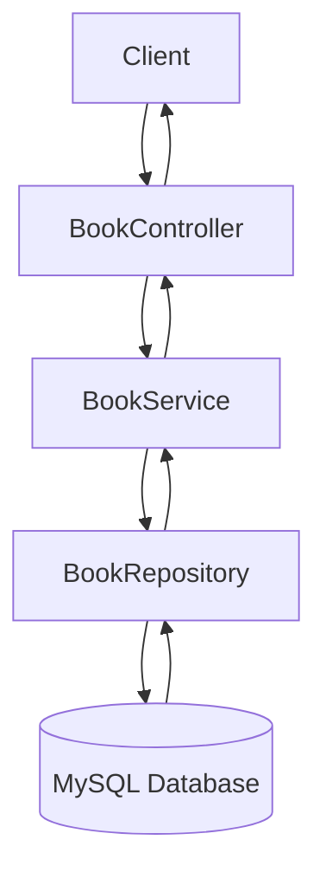

# Approach and Architecture
## 1. Technology Stack

The application was developed using the following technologies:

- Java 21

- Spring Boot
- Spring Data JPA
- MySQL
- Lombok
- Jakarta Validation
- JUnit 5 & Mockito (for unit testing)
- OpenAPI / Swagger (springdoc-openapi)
- Docker & Docker Compose

This technology stack was selected to ensure clean architecture, strong validation, automated documentation, and consistent deployment.

---

## 2. Application Architecture

The application follows a standard layered architecture:

### Controller Layer

- Handles HTTP requests and responses

- Validates request input using `@Valid`

- Delegates business logic to the service layer

- Annotated with OpenAPI documentation (`@Tag`, `@Operation`)

### Service Layer

- Contains all business logic

- Validates business rules:

  - Duplicate ISBN detection

  - Stock availability checks

  - Quantity validation

- Throws custom exceptions when rules are violated

### Repository Layer

- Uses Spring Data JPA

- Provides database interaction methods

- Includes derived query methods such as:

  - `findByAuthorContainingIgnoreCase`

  - `existsByIsbn`

  - `findByTitleContainingIgnoreCase`

### Database Layer

- MySQL database

- Table structure defined in `bookstore.sql`

- Initial sample data provided

---

## 3. Design Decisions
   ### Separation of Concerns

Business logic is placed in the Service layer, while the Controller layer only handles request mapping and responses.
This improves maintainability and testability.

### Custom Exceptions

Custom exceptions were created to improve clarity and structure:

- `BookNotFoundException` (by id)

- `NoBooksFoundException` (author + title)

- `DuplicateIsbnException`

- `InsufficientStockException`

All exceptions are handled centrally using a `GlobalExceptionHandler`.

This ensures:

- Consistent JSON error responses

- Proper HTTP status codes (400, 404, 409)

- Clean controller methods

---

## 4. Validation Strategy

Input validation is handled using Jakarta Validation annotations:

- `@NotBlank`

- `@Min`

- `@DecimalMin`

The controller uses `@Valid` to trigger validation automatically.

Business validation (e.g., stock checks) is handled in the service layer.

---

## 5. Testing Strategy

Unit testing was implemented using:

- JUnit 5

- Mockito

### BookServiceTest

- Mocks the `BookRepository`

- Tests core business logic

- Verifies:

  - Duplicate ISBN detection

  - Stock decrease on purchase

  - Stock increase on refund

  - Exception handling

### BookControllerTest

- Mocks the BookService

- Verifies:

  - Correct endpoint behavior

  - Exception propagation

  - Service method invocation

Service tests focus on business logic, while controller tests validate request handling.

---

## 6. OpenAPI Integration

OpenAPI was integrated using `springdoc-openapi`.

- Dependency added to `pom.xml`

- `OpenApiConfig` class created

- Controller annotated with:

  - `@Tag`

  - `@Operation`

This provides interactive API documentation via Swagger UI.

---

## 7. Containerisation Strategy

The application is containerised using Docker to ensure consistent deployment across environments.

Docker Compose is used to orchestrate two services:

- Spring Boot application container

- MySQL database container

The containers communicate through a Docker network, allowing the application to connect to the database using the service name as the host.

Benefits of this approach include:

- Environment consistency

- Simplified setup for team members

- Service isolation

- Easier deployment and testing

- Reduced configuration issues between systems

---

## 8. Code Quality and Best Practices

- Constructor injection using Lombok `@RequiredArgsConstructor`

- Logging using `@Slf4j`

- Clear package structure:

  - `controller`

  - `service`

  - `repository`

  - `entity`

  - `exception`

  - `request`

- Centralised error handling

- Clean separation between validation and business rules

---

This architecture ensures the system is:

- Maintainable

- Testable

- Scalable

- Easy to extend with additional features