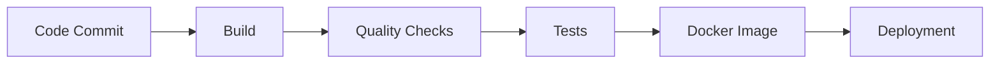

## Deployment Plan Using Docker
**CI/CD Pipeline Flow**

### **Introducing CI/CD Pipeline**
A CI/CD pipeline ensures changes to the code are automatically tested, built, and deployed in a consistent manner. Below is the outline of the pipeline:

#### Stages:

**1. Code Checkout**: Fetch the latest code from the vcs (e.g., GitHub/GitLab) whenever changes are pushed.

**2. Build Stage**: [Link Section](#3-build-stage)
- The application is built using Maven with the command `mvn clean package`.
- The result is a JAR file that becomes the build artifact.

**3. Code Analysis**:
- Tools which check for vulnerabilities, coding standard violations, and maintainability issues.

**4. Regression Testing**:
- Every test case in the file is run when any change in the code base is commited which include Unit and Integration testing using both old and new test case.
- If any test or quality check fails, the pipeline stops and deployment is blocked.

**5. Docker Image Build**: [Link Section](#4-docker-setup-and-configuration)
- The Dockerfile is used to create a container image that packages the application and runtime dependencies. 
- Example Command: `docker build -t bookstore .`

**6. Deploy to Staging Environment**: [Link Section](#6-deploy-docker-compose-to-staging-environment)
- Deploy the Docker image to a staging instance using `docker-compose`.
- Validate API endpoints and application functionality.

**7. Production Deployment**:
- Once validated in the staging environment, the pipeline deploys the application to production.
- Use environment-specific configurations (e.g., `.env` files) to maintain sensitive information securely.

## In our application
---

### **Prerequisites**
Before deploying, ensure the following prerequisites are in place:
**Docker Installed:** Ensure Docker is installed and running on the deployment machine (for all environments).
    - Install Docker Desktop on Windows: [Docker Installation Windows](https://docs.docker.com/desktop/setup/install/windows-install/)
    - Install Docker Desktop on Mac: [Docker Installation macOS](https://docs.docker.com/desktop/setup/install/mac-install/)

### 1. **Code Commited**
- Fetch and update the latest committed changes from the repository.

### 2. **Code Analysis and Testing**
- Execute unit and integration tests to validate the codebase and prevent regressions before deployment.

### 3. **Build Stage**
**Build Artifact (JAR):** Ensure your Java application is packaged as a `.jar` file with Maven.
    - Run: `mvn clean package` to generate the JAR file 
    - Alternative, use Intellij IDE build options: **Maven > bookstore >Lifecycle options > clean > package**

### 4. **Docker Setup and Configuration**
**Configure `Dockerfile` & `docker-compose.yml`:** Confirm the Dockerfile and docker-compose configuration is properly set up. Use the provided files as templates.

1. **Set Up `Dockerfile`**
  - The provided `Dockerfile` uses an OpenJDK base image to run the Spring Boot application.
  - It copies the built JAR file into the Docker image and sets the entry point to run the application.
  - Ensure the JAR file name in the `Dockerfile` matches the actual built JAR file name from your Maven build - can be found in target/ directory.


2. **Set Up `docker-compose.yml`**
- The provided `docker-compose.yml` includes:
  - A MySQL service (used as the database for the application).
  - The bookstore application, configured to connect to the database.
  - The `docker-compose.yml` mounts SQL scripts from the directory `<YOUR_LOCAL_PATH>/src/main/resources/sql` into the MySQL container at `/docker-entrypoint-initdb.d`.
  - Ensure this directory is **change to your own absolute path** as it contains all required scripts to initialise the database schema and seed the data.
      ```yaml
          volumes:
             - <YOUR_LOCAL_PATH>/src/main/resources/sql:/docker-entrypoint-initdb.d
       ```
> [!CAUTION]
> Database connection details like username, passwords, and database name are already set in the `docker-compose.yml`. Ensure these align with your application's configuration. However, for this project development simplicity, the credentials are hardcoded - it does not correspond to anyone password. 

> [!NOTE]
>  For the production environment, it is recommended to use environment variables or a `.env` file to avoid hardcoding sensitive information in the `docker-compose.yml`. Refers to note on using environment variables for production deployment.

### 5. **Docker Image Build**
**Build the Docker Image:**
    - Run: `docker build -t bookstore .`
    - This step creates a Docker image using the `Dockerfile`.

### 6. **Deploy Docker Compose to Staging Environment**
1. **Start the Services:**
    - Command: `docker compose up -d`
    - This will:
        - Build the application image (if not already built).
        - Start both the MySQL database and the bookstore application container.
        - Map port 8080 of the container to port 8080 of the host machine.

2. **Verify Deployment:**
    - Open a browser or Postman and navigate to `http://localhost:8080`. 
    - You may use `.http` file provided or swagger ui to facilitate quicker test on endpoints.
    - If the application APIs/UI is accessible, the deployment is successful.


#### Good Practices:
> 1. Automate the pipeline using CI/CD tools like GitHub Actions, Jenkins, or GitLab CI/CD.
> 2. Run stages in parallel whenever possible (e.g., unit tests and static code analysis) to save time.
> 3. Ensure rollback mechanisms are in place in case of deployment failures.

> [!WARNING]
>1. **Sensitive Information**: Never hardcode sensitive information such as passwords or API keys in pipeline scripts. Use secret managers (e.g., AWS Secrets Manager or environment variables).
>2. **Environment Parity**: Keep staging and production setup as close as possible to avoid surprises during deployment.
>3. **Skipping Tests**: Do not skip tests or checks even for small changes to avoid introducing undetected issues.

### **Note for Production**
For a production environment, consider the following adjustments:
**Use Environment Variables:**
    - Avoid storing sensitive details (like passwords) in the `docker-compose.yml`. Replace them with environment variables or a `.env` file.
    - Example `.env` file:
``` env
     MYSQL_USER=bookstore_user
     MYSQL_PASSWORD=bookstore_pass
     SPRING_DATASOURCE_URL=jdbc:mysql://db:3306/bookstore
     SPRING_DATASOURCE_USERNAME=bookstore_user
     SPRING_DATASOURCE_PASSWORD=bookstore_pass
```
